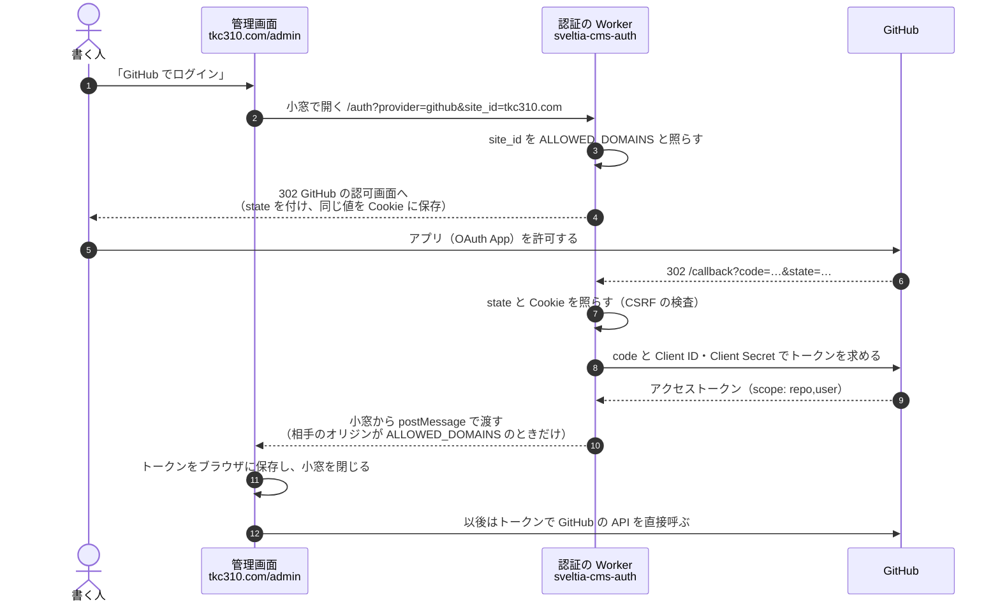
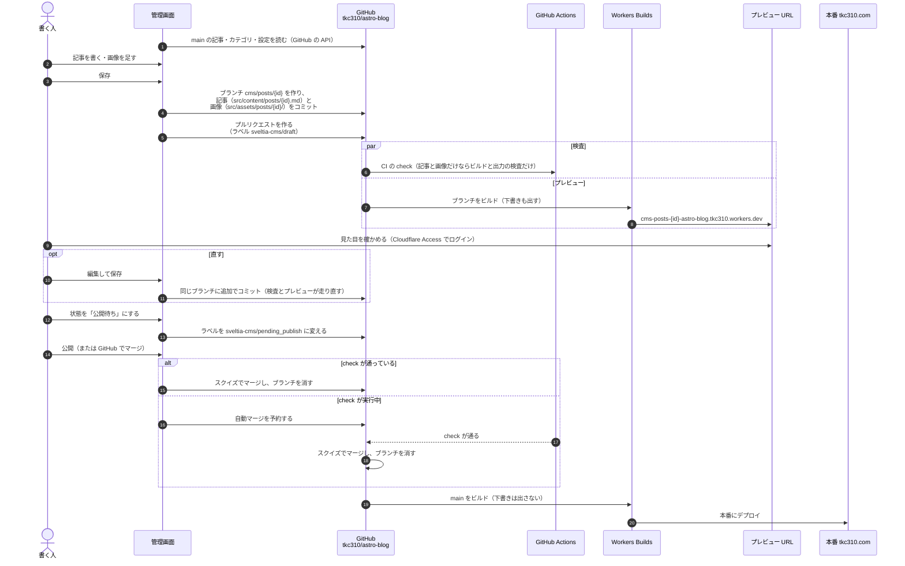

# 管理画面（Sveltia CMS）の仕組み

管理画面（`/admin`）は Sveltia CMS で、データベースもサーバも持たない（ADR-0004）。ブラウザの中で動く JavaScript が、GitHub の API でこのリポジトリを直接読み書きする。本体は npm のパッケージ（`@sveltia/cms`）を Astro でまとめてこのサイトから配り、外部の CDN からは読まない（ADR-0022）。記事の正本はリポジトリの Markdown のままで、管理画面はそれを編集する道具にすぎない。

| 部品                  | 置き場所                                                                                            | 役割                                                                                                       |
| --------------------- | --------------------------------------------------------------------------------------------------- | ---------------------------------------------------------------------------------------------------------- |
| 管理画面              | `src/pages/admin.astro`・`public/admin/config.yml`・`public/_headers`（`https://tkc310.com/admin`） | Sveltia CMS の本体を読み込むページ（ビルドでまとめた `/_astro/` のスクリプト）、設定、読み込み先を絞る CSP |
| 認証の Worker         | `tkc310/astro-blog-sveltia-cms-auth`（`astro-blog-sveltia-cms-auth.tkc310.workers.dev`）            | GitHub の OAuth のやり取りを中継し、アクセストークンを管理画面に渡す                                       |
| GitHub の OAuth App   | GitHub の Developer settings                                                                        | ログインの許可画面と、トークンの発行                                                                       |
| ブログの Worker と CI | Workers Builds・GitHub Actions                                                                      | ブランチのプレビュー URL へのデプロイ、検査、`main` の本番デプロイ                                         |

秘密の値（OAuth App の Client Secret）は、認証の Worker の環境変数にだけある。管理画面にもこのリポジトリにも置かない。

管理画面のスクリプトは、ログインした人の GitHub のトークン（`repo` 権限）を持って動く。そのため本体は自分で配り、`/admin` には Content-Security-Policy を付けて、スクリプトはこのサイトのものだけ、通信はこのサイトと GitHub だけに絞っている（`public/_headers`）。本体の版は `package.json` で固定し、上げるときは PR とプレビューで管理画面を確かめる。

## 1. ログイン（認証）

ブラウザだけでは OAuth の Client Secret を安全に持てないので、トークンの交換だけを認証の Worker が行う。管理画面は小窓（ポップアップ）で Worker を開き、`postMessage` でトークンを受け取る。

- 戻り先（`/callback`）は、OAuth App の Redirect URIs に登録した 1 件だけ。認証の Worker は GitHub に `redirect_uri` を送らないので、GitHub は登録した URL に戻す。ワイルドカードの一致は使わない
- `ALLOWED_DOMAINS`（`tkc310.com`）は 2 か所で効く。ほかのサイトからこの Worker でログインを始めること（手順 3）と、ほかのサイトにトークンを渡すこと（手順 10）を止める
- トークンは書く人の GitHub の権限で動く。このリポジトリに書き込めない人は、ログインできても保存できない
- 認証の Worker が働くのはログインのときだけ。記事を読み書きする通信は、管理画面と GitHub の間で直接行う

## 2. 記事の追加・編集

保存の方式は Editorial Workflow（`publish_mode: editorial_workflow`）。管理画面で保存すると `main` に直接は書かず、記事ごとのブランチとプルリクエストを作る。公開はそのプルリクエストのマージで、ほかの変更と同じ CI と検査を通る。

- 管理画面の項目は `config.yml` に、記事の形式の検査は Astro の Zod スキーマ（`src/content.config.ts`）にある。2 つがずれていないかを `scripts/cms-config.test.ts` が確かめる。項目を足すときは両方を直す（`rules/content.md`）
- ファイル名（`<id>`）は記事の URL（`/articles/<id>`）になる。管理画面では作るときにだけ入力でき、あとから変えられない
- 管理画面は保存のたびに Markdown を自分の形（表の列をそろえない・入れ子の箇条書きの字下げ 4）で書き直す。`src/content/` は整形の検査（`make lint`）から外してあるので、これで CI は落ちない（ADR-0023）。エディタで書くときも整形は任意
- 記事が増えてページ送りのページが増えると、旧ブログ用の 301（`public/_redirects`）が新しいページを隠すことがある。`make check-output` が見つけるので、その行を消す
- 状態のラベル（`sveltia-cms/draft`・`pending_review`・`pending_publish`）は管理画面の「ワークフロー」の列の位置を表すだけで、公開を止める仕組みではない。公開を止めるのは、記事の `draft: true` と、プルリクエストをマージしないこと
- GitHub で直接マージしても、管理画面から公開しても結果は同じ。マージしたあと、管理画面は `main` を読み直す
- 画像は記事の編集画面（本文の画像のボタンやドラッグ）から足す。記事のブランチとプルリクエストに入り、`src/assets/posts/{id}/` に置かれる。「すべてのアセット」「グローバルアセット」の画面からのアップロードは、Editorial Workflow を通らずに `main` へ直接コミットしようとするので、PR を必須にした `main` の保護に拒まれて失敗する（置き場所も記事の画像の場所と違う）
- 「公開」はスクイズマージで行う（`config.yml` の `squash_merges: true`）。`main` の保護がスクイズだけを許すので、これが無いと拒まれる（ADR-0024）
- 必須の検査（`check`）が実行中のときに「公開」を押すと、Sveltia CMS は GitHub の自動マージを予約し、検査が通った時点で GitHub がマージする。管理画面を閉じてもマージされる。リポジトリの設定で「Allow auto-merge」が有効になっている必要がある
- 変更が記事と画像（`src/content/`・`src/assets/posts/`）だけの PR では、`check` はビルドとビルド結果の検査だけで、Lighthouse と撮影は回らない（ADR-0024）
