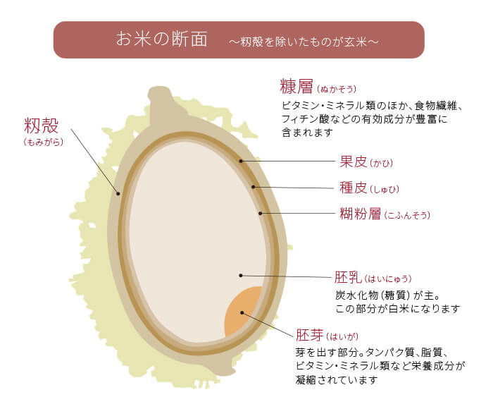

最近、集中力が高まったり認知症予防にも有効な「マインド食」というものを試しています。
マインド食ではミネラルや食物繊維が豊富なため血糖値の急上昇を防ぐ「全粒穀物」の摂取を推奨しています。
玄米・発芽玄米・雑穀米などはこの全粒穀物のカテゴリーに入るということで、最近は白米以外のお米を食べるようにしています。

ただ、ふと「白米、玄米、発芽玄米、雑穀米」の違いってなんだろうと思い立ったので調べてみました。

マインド食についてはこちら↓

[special.nissay-mirai.jp/jinsei100y/hints/AXKkA](https://special.nissay-mirai.jp/jinsei100y/hints/AXKkA)

## 違いについて

こちらの記事を参考にしました↓

[smartagrifood.jp/?mode=f47](https://smartagrifood.jp/?mode=f47)
[nlab.itmedia.co.jp/hc/articles/1603/05/news013.html](https://nlab.itmedia.co.jp/hc/articles/1603/05/news013.html)

大きく「籾殻、胚芽、糠層」という層があり、主にその層の削り具合によって呼び方が変わるようです。
(発芽玄米、雑穀米は別)

- 白米 (精白米)

もっとも加工されたお米。
籾殻、胚芽、糠層全てを削り取った状態

- 胚芽米

籾殻、糠層まで削った状態
胚芽が8割以上残るように精米している

- 玄米

籾殻だけ削った状態

- 発芽玄米

玄米に少しお水を与えて、わずかに発芽させた状態
玄米に比べて栄養素が優れるところも劣るところもある

- 雑穀米

白米、玄米、あわ、ひえ、きび、ハト麦、押し麦、黒米など複数の雑穀を混ぜたもの

他はなんとなく予想がつきますが、発芽玄米はユニークな作り方ですね。
雑穀米は他のお米に混ぜて使う用のものが売っているので、雑穀米は併用する感じになりそうです。

## 全粒穀物フードを紹介

近くのスーパーでは2kg単位で玄米が置いてなかったので、amazonで購入しています。
無洗米の玄米とかもあるんですね。
雑穀米は高くてコスパが悪かったので、2~3合につき１袋混ぜるタイプのものを購入しています。

- 金芽ロウカット玄米(無洗米) 【長野県産コシヒカリ】4kg【2kg×2】

[amzn.to/3pApljL](https://amzn.to/3pApljL)

- 神明 米屋のこだわり 十八穀米 550g(25g×22包)

[amzn.to/3bqDkDN](https://amzn.to/3bqDkDN)

あとは「全粒粉パスタ」という全粒穀物を利用したパスタ、ペンネがあったのでこちらも食べています。
玄米は香りが変わって美味しいのですが、パスタ・ペンネはボソボソ感が強くて苦手な人が多そうだなと思います。
(香りは豊かですが、歯ざわりがざらつき・つなぎが悪い感じの食感です)

- ALCE NERO(アルチェネロ)有機全粒粉スペルト小麦・スパゲッティ 500g

[amzn.to/3btEsXp](https://amzn.to/3btEsXp)

- ALCE NERO(アルチェネロ) 有機全粒粉フジッリ 500g (ペンネ)

[amzn.to/37yBhMG](https://amzn.to/37yBhMG)
