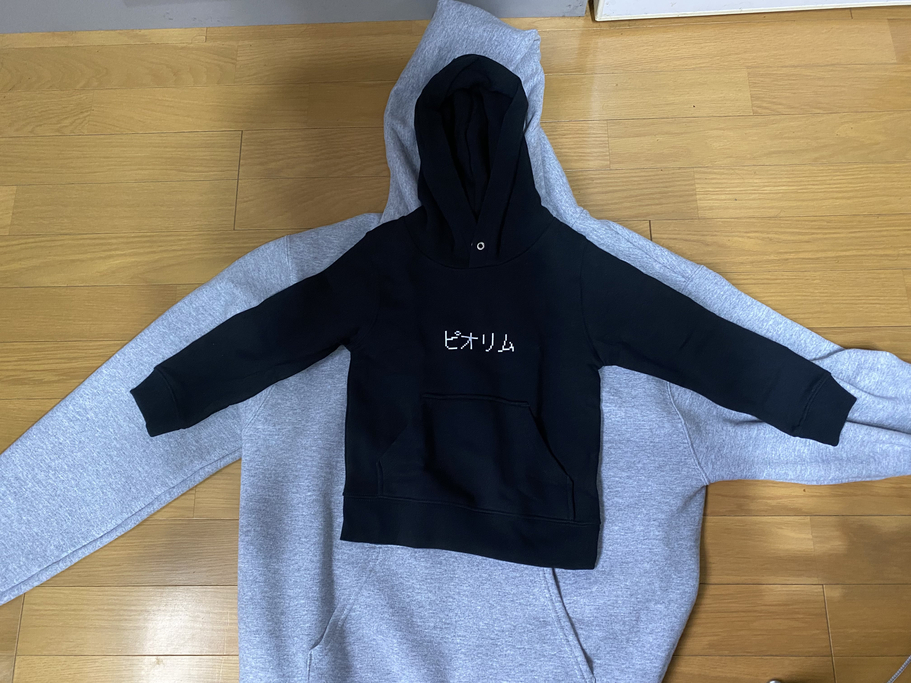

いまさらドラクエ10をやり込み始めたのでパーカーを作りました。
https://up-t.jp/market/637681b6dc348

リレミト・スクルト・ルカナン辺りの呪文も魅力的でしたが、誤解を与えにくいピオリムに軍配が上がりました。

怒られそうなため在庫は0にしています。

---

_後日談_

間違ってキッズサイズを注文してしまい、  
34歳にして本格的に迷走しているなと思うこの頃

---

全然関係ないけどバックエンドTSを勉強しようと思って調べてたら、一休さんが興味深い挑戦をしていた。
https://speakerdeck.com/naoya/typescript-niyoru-graphql-batukuendokai-fa-75b3dab7-90a8-4169-a4dc-d1e7410b9dbd
スイッチコストを減らすためにクラサバTSにして更に宣言的アーキテクチャで揃えるのは夢があると思って見ている。

まだ時代が追いついていない気がするけど、持ちうる状態のパターンを事前に用意して遷移はフレームワークに任せるというのは見通しも良くなりテスタブルにもなりそうなので、かなり良さそう。
ただ現状は自前でルールを作る必要があるので、実戦投入にはエネルギーを使いそう。
