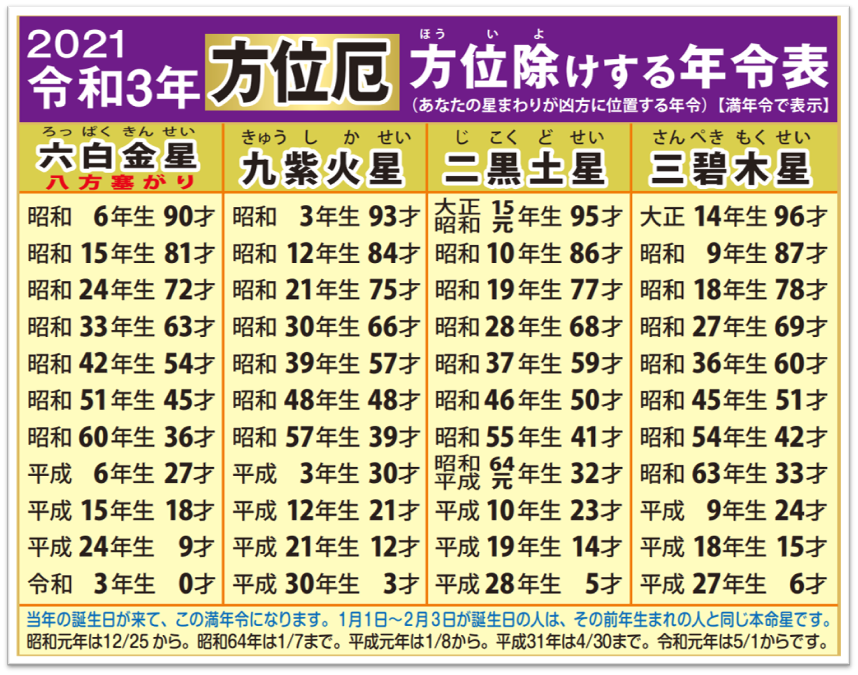
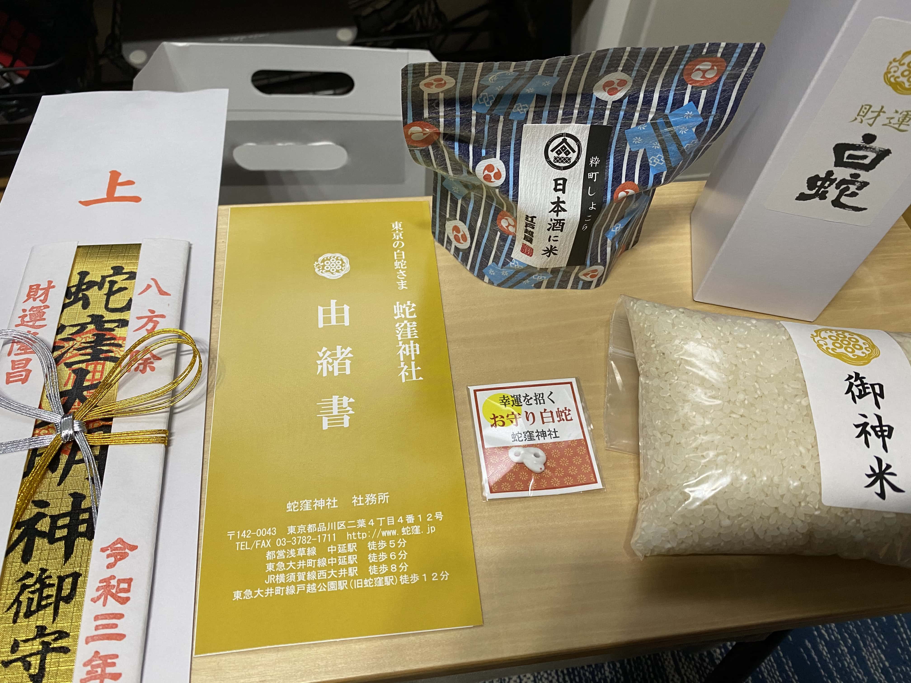

近所に割と有名な「蛇窪神社」という場所があり、白蛇・龍神の神様を祀っている神社ということで金運のご利益がありそうです。

よく散歩途中によって邪な気持ちで参拝していますが、「方位厄」という厄年以外にもプチ厄がある年回りがあるという看板が前から気になっていました。
方位厄を払う「八方除け」という祈願を受けてきました。

## 八方除け祈願について

ご祈祷は他の神社でも受けたことがありましたが、こちらの神社は手順が多かったような気がしました。
また、コロナ渦の平日ということもあり閑散としていて、祈祷を受けたのは私一人で若干のゴージャス感がありました笑

詳細はこちら↓
[hebikubo.jp/kitou](https://hebikubo.jp/kitou/)

神主さんと巫女さんに30分位ご祈祷していただいて、記念品を受け取って帰りました。

## 記念品

たくさん入っていて驚きました。

- お神酒 (清酒)
- おしゃれなチョコ
- お神札
- お米
- 白蛇のお守り (かわいい)

初穂料として5000円を納めましたが、私一人のために30分祈祷していただいて記念品もたくさんもらえたので少し驚きました。
(バチ当たりかもしれませんが、大満足です)
また、散歩で寄り道して参拝したいと思います。
